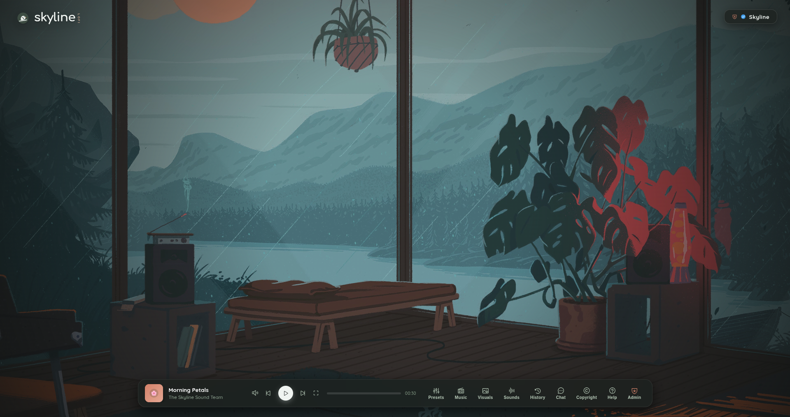

### Version 4

### A minimalist, cozy lofi player for focus, studying, and late-night vibes.

 

---

## ✨ What's Inside

- 🎵 **Curated Lofi Radio** — Handpicked instrumental beats built for zero-distraction focus.
- 🖼️ **Animated Scenes & Presets** — Switch between atmospheric visual backdrops and saved mood presets[cite: 2].
- 📜 **Listening History & Quick Controls** — Revisit recently played tracks, jump through the playlist, and control playback from a clean floating dock[cite: 2].
- 💬 **Live Community Chat** — Hang out with other listeners in real time, complete with role badges for Verified users and Admins[cite: 2].
- 🔒 **Zero Ads, Zero Tracking** — Free, open-source, and built purely for the vibe.

---

## 🎹 Submit Your Music (For Producers & Artists)

> **Just here to listen?** Jump straight into the [Skyline Web App](https://prismid.github.io/skyline-lofi/).

Want your beats featured on Skyline? To keep the vibe consistent, every submitted track **must** meet these rules:

| Requirement | Details |
| :--- | :--- |
| 🚫 **No Lyrics** | Instrumental / lofi beats only |
| ⏱️ **Minimum Length** | At least **1 minute, 30 seconds** long |
| ©️ **100% Original** | You own full rights to the track |

### How to Submit
1. Read the full [Song Upload Guidelines](https://github.com/PrismID/skyline-lofi/wiki/Song-Upload).
2. Open a [**GitHub Issue**](https://github.com/PrismID/skyline-lofi/issues) with your track *(new to Issues? Check out [GitHub's Creating an Issue Article](https://docs.github.com/en/issues/tracking-your-work-with-issues/using-issues/creating-an-issue))*.
3. **The Skyline Sound Team** will review your track before merging it into the live rotation.

> ⚠️ **Warning:** Submitting copyrighted music or violating the [submission guidelines](https://github.com/PrismID/skyline-lofi/wiki/Song-Upload) may result in a temporary or permanent ban from future submissions.

---

## 🛠️ Built With

Built from scratch with **3,300+ lines of code** across **HTML, CSS, JavaScript, SVG, and JSON**—powered by Firebase Authentication and Cloud Firestore.

## 📄 License

Open-source under the [MIT License](LICENSE).
